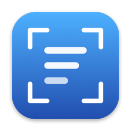

<div align="center">



# Teleclip

**화면에 보이는 글자를 드래그 한 번으로 클립보드에**

복사가 막힌 VDI·원격 화면에서도, 메뉴바 앱 하나로

[](https://github.com/parktaeyang/Teleclip/releases/latest) [](#a-homebrew로-설치-권장) [](#요구-사항) [](LICENSE)

</div>

## 왜 만들었나요?

VDI(Omnissa Horizon 등) 원격 화면은 보안 정책 때문에 **복사·붙여넣기가 막혀 있는 경우**가 많습니다.
Mac 입장에서 그 화면은 글자가 아니라 '그림'이라서, 아이디 하나 옮기려 해도 손으로 다시 쳐야 하죠.

Teleclip은 그 '그림'에서 글자를 읽어(OCR) **Mac 클립보드에 바로 넣어 줍니다.**
VDI뿐 아니라 이미지, PDF 스캔본, 영상 자막, 복사가 안 되는 웹페이지 등 **화면에 보이는 글자라면 어디서든** 쓸 수 있습니다.

## 주요 기능

- **드래그 한 번으로 복사**: 단축키를 누르고 글자가 있는 영역을 드래그하면 끝. 바로 `⌘V` 로 붙여넣을 수 있어요.
- **한글 + 영어 인식**: 한국어와 영어가 섞여 있어도 함께 읽습니다.
- **표 모양 그대로**: 같은 줄에 있는 글자는 한 줄로, 줄은 줄대로 유지합니다.
- **엑셀·시트에 바로 붙여넣기**: 탭 구분 모드(`⌃⇧3`)로 복사하면 표가 셀별로 나뉘어 들어갑니다.
- **스크린샷 + 미리보기**: `⌃⇧4` 로 캡처하면 파일로 저장하고 화면 구석에 미리보기를 띄웁니다. 클릭해서 도형·글씨를 넣거나, 클립보드에 복사하거나, 드래그해서 다른 앱에 바로 넣을 수 있어요.
- **글자를 멋대로 고치지 않음**: 아이디·숫자·이메일처럼 사전에 없는 문자열도 보이는 그대로 옮깁니다.
- **내 Mac 안에서만 처리**: Apple 내장 OCR(Vision)을 쓰며, 화면이나 글자를 **외부로 보내지 않습니다.**
- **메뉴바에 조용히**: Dock 아이콘 없이 메뉴바에만 있고, 로그인 시 자동 실행도 켤 수 있어요.

## 단축키

| 단축키 | 동작 | 이럴 때 |
|---|---|---|
| `⌃⇧2` (Control + Shift + 2) | 캡처 → **공백**으로 구분해 복사 | 문장, 아이디, 메모 등 일반 텍스트 |
| `⌃⇧3` (Control + Shift + 3) | 캡처 → **탭**으로 구분해 복사 | 표를 엑셀·구글 시트에 붙여넣을 때 |
| `⌃⇧4` (Control + Shift + 4) | 캡처 → **이미지 파일로 저장** + 미리보기 | 화면을 그림 그대로 남기거나 전달할 때 |

드래그 중 `Esc` 를 누르면 취소됩니다. 메뉴바 아이콘을 눌러 같은 기능을 실행할 수도 있습니다.

**예시**: 화면에 이런 표가 있을 때

```
이름     부서     내선
홍길동   개발팀   1234
```

`⌃⇧3` 으로 캡처해 엑셀에 붙여넣으면 `이름 | 부서 | 내선` 처럼 칸이 나뉘어 들어갑니다.

## 스크린샷 미리보기

`⌃⇧4` 로 영역을 캡처하면 이미지가 저장되고, **마우스가 있는 화면의 오른쪽 아래**에 작은 미리보기가 뜹니다.
전체화면 앱 위에서도, 모니터가 여러 대여도 항상 뜹니다.

| 동작 | 결과 |
|---|---|
| 클릭 | 편집 창 열기 (도형·글씨 넣기) |
| 드래그 | 메신저·메일·문서 등 다른 앱으로 파일 전달 |
| 우클릭 | 편집 / 미리보기 앱으로 열기 / Finder에서 보기 / 이미지 복사 / 텍스트 복사(OCR) / 휴지통으로 이동 |
| 마우스를 올리면 | 왼쪽 위 닫기, 오른쪽 위 휴지통, 아래 가운데 **복사**(이미지를 클립보드에) 버튼 |
| 그대로 두면 | 6초 뒤 자동으로 사라짐 (파일은 남아 있어요) |

### 편집 창

미리보기를 클릭하면 편집 창이 열립니다.

| 도구 | 사용법 |
|---|---|
| 사각형 / 화살표 | 드래그해서 그리기 |
| 펜 | 드래그해서 자유롭게 그리기 |
| 글씨 | 넣을 자리를 클릭하고 입력한 뒤 `Return` |
| 색 | 빨강 · 노랑 · 초록 · 파랑 · 검정 · 흰색 |
| 실행 취소 (`⌘Z`) | 마지막으로 넣은 것 지우기 |
| **복사 + 저장** (`Return`) | 편집한 이미지를 클립보드에 복사하고 파일에도 저장한 뒤 닫기 |
| 취소 | 저장하지 않고 닫기 |

### 저장

- **저장 위치**: macOS 스크린샷 저장 위치 설정을 그대로 따릅니다. 설정이 없으면 데스크탑에 저장합니다.
- **파일 이름**: `Teleclip 2026-11-26 15.04.05.png` 형식입니다.
- 저장 위치가 문서·데스크탑 폴더라면 처음 한 번 macOS가 폴더 접근 허용을 물어볼 수 있습니다.

## 설치

### A. Homebrew로 설치 (권장)

터미널에 한 줄이면 됩니다.

```sh
brew install --cask parktaeyang/tap/teleclip
```

| 하고 싶은 것 | 명령 |
|---|---|
| 최신 버전으로 업데이트 | `brew upgrade --cask teleclip` |
| 삭제 | `brew uninstall --cask teleclip` |
| 설정까지 완전히 삭제 | `brew uninstall --zap --cask teleclip` |

> Homebrew가 없다면 [brew.sh](https://brew.sh/ko/)의 설치 명령을 먼저 실행하세요.

### B. 직접 다운로드

1. [**Releases**](https://github.com/parktaeyang/Teleclip/releases/latest) 에서 `Teleclip-<버전>.dmg` 를 내려받습니다.
2. DMG를 열고 **Teleclip.app** 을 **Applications** 폴더로 끌어 놓습니다.

## 처음 실행하기

### 1. 실행 허용 (처음 한 번)

Teleclip은 개인 개발자가 직접 서명한 앱이라 Apple 공증을 받지 않았습니다. 그래서 처음 열 때 macOS가 실행을 막을 수 있습니다.

- **macOS 15 이상**: Teleclip을 한 번 연 뒤, **시스템 설정 → 개인정보 보호 및 보안** 아래쪽의 **"그래도 열기"** 를 누릅니다.
- **macOS 14 이하**: Applications 폴더에서 Teleclip을 **우클릭 → 열기** 합니다.

### 2. 화면 기록 권한 허용

화면의 글자를 읽으려면 **화면 기록** 권한이 필요합니다.

1. Teleclip이 **"화면 기록 권한이 필요합니다"** 창을 띄우면 **권한 허용** 을 누릅니다.
2. **시스템 설정 → 개인정보 보호 및 보안 → 화면 기록** 에서 **Teleclip** 을 켭니다.
3. Teleclip으로 돌아와 **다시 시작** 을 누릅니다. (macOS는 권한을 켠 뒤 앱을 다시 켜야 적용됩니다)

메뉴바 아이콘을 눌러 **"화면 기록 권한: 허용됨"** 이 보이면 준비 완료입니다.

> 한 번 허용하면 **업데이트해도 권한이 유지**됩니다. (macOS 15 이상은 시스템이 가끔 "계속 허용할지" 다시 물어볼 수 있어요.)

## 메뉴바

메뉴바의 Teleclip 아이콘을 누르면 다음 항목이 있습니다.

| 항목 | 설명 |
|---|---|
| 화면 기록 권한 | 현재 권한 상태. 필요할 때 누르면 허용 안내를 엽니다 |
| 다시 시작 (권한 적용) | 권한을 허용한 뒤 앱을 다시 켭니다 |
| 캡처 → 클립보드 (공백 / 탭) | 단축키와 같은 기능 |
| 스크린샷 → 미리보기 | `⌃⇧4` 와 같은 기능 |
| 로그인 시 자동 실행 | 켜 두면 Mac을 켤 때 자동으로 실행됩니다 |
| Teleclip v버전 | 지금 설치된 버전 |
| 종료 | Teleclip 종료 (`⌘Q`) |

## 문제 해결

<details>
<summary><b>캡처해도 아무것도 복사되지 않아요</b></summary>

- 메뉴바 아이콘에서 **화면 기록 권한** 상태를 확인하세요. "허용됨"이 아니라면 권한을 켠 뒤 **다시 시작 (권한 적용)** 을 누르세요.
- 선택한 영역에 글자가 너무 작거나 흐리면 인식되지 않을 수 있습니다. 화면을 확대한 뒤 다시 캡처해 보세요.

</details>

<details>
<summary><b>"Teleclip을 열 수 없습니다" / "확인되지 않은 개발자" 경고가 떠요</b></summary>

위 [실행 허용](#1-실행-허용-처음-한-번) 단계를 따라 주세요. 처음 한 번만 하면 됩니다.

</details>

<details>
<summary><b>단축키가 동작하지 않아요</b></summary>

다른 앱이 `⌃⇧2` / `⌃⇧3` / `⌃⇧4` 를 이미 쓰고 있을 수 있습니다. 메뉴바 아이콘의 캡처 항목으로 동작하는지 확인해 보세요.

</details>

<details>
<summary><b>1.0 버전에서 업데이트했는데 자동 실행이 꺼졌어요</b></summary>

1.1부터 앱 식별자(번들 ID)가 `com.teleclip.app` → `io.github.parktaeyang.teleclip` 으로 바뀌었습니다.
**로그인 시 자동 실행** 을 다시 켜고, 화면 기록 권한도 한 번 다시 허용해 주세요.
시스템 설정의 화면 기록 목록에 남은 옛 항목은 지워도 됩니다: `tccutil reset ScreenCapture com.teleclip.app`

</details>

## 요구 사항

- macOS 13 (Ventura) 이상
- Apple Silicon / Intel 모두 지원

## 개인정보

- 글자 인식은 Apple **Vision** 프레임워크로 **Mac 안에서만** 처리합니다.
- 글자 복사(`⌃⇧2`, `⌃⇧3`)로 캡처한 이미지는 인식 직후 삭제되고, 인식 결과는 클립보드에만 들어갑니다.
- 스크린샷(`⌃⇧4`)은 **내 Mac의 저장 위치에만** 이미지 파일로 남습니다.
- 어떤 데이터도 외부 서버로 보내지 않습니다.

## 개발자용

<details>
<summary><b>빌드 방법</b></summary>

```sh
./build-app.sh       # Teleclip.app 빌드 (유니버설)
open Teleclip.app    # 실행
./build-release.sh   # 배포물: dist/Teleclip-<버전>.zip, .dmg, SHA256SUMS
```

- 환경변수: `TELECLIP_VERSION`(기본 `1.0`), `TELECLIP_SIGN_MODE`(`local` | `developer-id` | `ad-hoc`)
- 지정하지 않으면 `signing/setup-local-signing.sh --create-and-trust` 로 만든 자체 서명 인증서가 키체인에 있을 때 `local`, 없으면 `ad-hoc`(업데이트마다 권한 재허용 필요)으로 빌드합니다. 자세한 옵션은 `build-app.sh` 머리 주석을 보세요.

CLI 단독 버전:

```sh
./build.sh
./teleclip          # 공백 구분
./teleclip --tab    # 탭 구분
```

</details>

<details>
<summary><b>릴리스 방법</b></summary>

`v1.2.0` 같은 태그를 푸시하면 GitHub Actions가 서명·빌드해 Release에 올리고,
Homebrew tap([parktaeyang/homebrew-tap](https://github.com/parktaeyang/homebrew-tap))의 cask를 자동으로 갱신합니다.

```sh
git tag v1.2.0 && git push origin v1.2.0
```

필요한 secret: `TELECLIP_SIGNING_P12_BASE64`, `TELECLIP_SIGNING_P12_PASSWORD`, `TAP_GITHUB_TOKEN`

</details>

<details>
<summary><b>동작 원리</b></summary>

- macOS 내장 `screencapture -i` 로 영역 선택
- Apple Vision으로 한/영 OCR (`usesLanguageCorrection = false` — 사전 보정이 아이디·숫자를 바꿔버리는 문제 방지, 예: `2` → `?`)
- 인식된 조각을 세로 위치로 '같은 줄'로 묶고(글자 높이의 0.6배 기준), 줄 안에서는 왼쪽부터 이어 붙여 표 구조 보존
- 결과를 `NSPasteboard` 에 복사
- 스크린샷 모드는 임시 파일로 캡처한 뒤 저장 위치로 옮기고, 모든 Space·전체화면 위에 뜨는 `NSPanel` 로 미리보기 표시
- 편집 창은 주석(도형·글씨)을 원본과 같은 픽셀 크기의 비트맵에 합성해 PNG로 저장

</details>

## 라이선스

[MIT](LICENSE) © 2026 박태양
